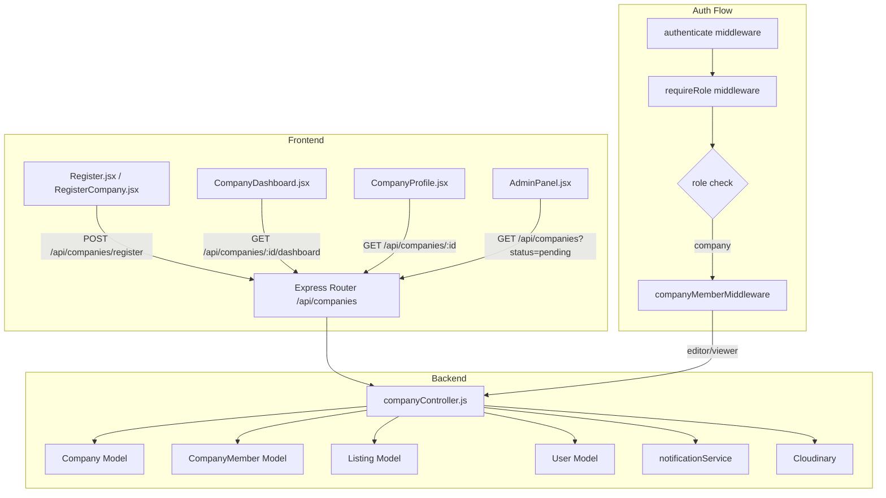

# Design Document: Company Actor

## Overview

The Company Actor feature introduces a `company` role to the EthioDelala marketplace. Unlike the `broker` role (individual agents), a Company is a verified legal entity — banks, construction firms, car dealerships, employers — that publishes listings and content under a corporate brand.

The feature integrates into the existing system by:
- Adding two new Mongoose models: `Company` and `CompanyMember`
- Extending the `Listing` model with `ownerType` and `companyOwner` fields
- Adding a `company` value to the User `role` enum (assigned post-verification)
- Introducing new API routes under `/api/companies`
- Adding a `CompanyDashboard` frontend page and a multi-step company registration flow
- Extending the existing `requireRole` middleware and `DashboardRouter` to handle the `company` role

The design deliberately reuses existing infrastructure: Cloudinary for file uploads, the existing `notificationService` for in-app notifications, the existing `authenticate` + `requireRole` middleware for access control, and Redux Toolkit for frontend state.

---

## Architecture



### Key Architectural Decisions

1. **Company as a separate document, not a User sub-document**: Companies have their own lifecycle (verification, suspension, deletion) independent of the User who created them. A separate `Company` collection is cleaner and avoids bloating the User document.

2. **`ownerType` discriminator on Listing**: Rather than a separate `CompanyListing` collection, we add `ownerType: { 'individual' | 'company' }` and `companyOwner` to the existing `Listing` schema. This keeps search, filtering, and existing listing logic intact with minimal changes.

3. **Company_Admin's User role becomes `company`**: After verification, the admin's `role` field is updated from `user`/`broker` to `company`. This integrates with the existing JWT-based auth — the role is embedded in the access token and checked by `requireRole`.

4. **CompanyMember permissions via middleware**: A dedicated `requireCompanyMember(role)` middleware checks the `CompanyMember` collection for the requesting user's membership and role within a specific company, layered on top of the existing `authenticate` middleware.

---

## Components and Interfaces

### Backend Components

#### `Company` Model (`backend/src/models/Company.js`)
New Mongoose model representing a verified legal entity.

#### `CompanyMember` Model (`backend/src/models/CompanyMember.js`)
New Mongoose model representing a user's membership in a company.

#### `companyController.js` (`backend/src/controllers/companyController.js`)
Handles all company-related business logic:
- `registerCompany` — create company, notify admins
- `approveCompany` / `rejectCompany` — admin verification actions
- `updateCompanyProfile` — profile management
- `inviteMember` / `acceptInvitation` / `declineInvitation` / `removeMember` / `updateMemberRole` — team management
- `getCompanyDashboard` — aggregated analytics
- `listCompanies` — public discovery endpoint
- `getCompanyListings` — paginated listings for a company profile
- `suspendCompany` / `reactivateCompany` / `deleteCompany` / `transferAdmin` — admin management
- `createCompanyListing` / `bulkCreateCompanyListings` — listing creation
- `submitContactInquiry` — contact form submission

#### `companyRouter.js` (`backend/src/routes/companies.js`)
Express router mounted at `/api/companies`.

#### `requireCompanyMember` middleware
Checks that the authenticated user is an active member of the company specified in `req.params.companyId`, and optionally that their `memberRole` is in the allowed list.

```javascript
// Usage:
requireCompanyMember('editor')   // editor or admin
requireCompanyMember('viewer')   // any active member
requireCompanyMember()           // company admin only
```

### Frontend Components

#### Pages
- `RegisterCompany.jsx` — multi-step company registration form (company info → document upload → review)
- `CompanyDashboard.jsx` — role-aware dashboard for company admin and members
- `CompanyProfile.jsx` — public-facing company brand page

#### Store
- `companySlice.js` — Redux slice for company state (profile, members, listings, dashboard stats)

#### Routing additions in `App.jsx`
- `/register-company` — public (requires authenticated user)
- `/company-dashboard` — protected, role `company`
- `/companies/:id` — public company profile page

---

## Data Models

### Company Model

```javascript
const companySchema = new Schema({
  // Identity
  companyName:               { type: String, required: true },
  businessRegistrationNumber:{ type: String, required: true, unique: true },
  businessRegistrationDoc:   { type: String, required: true }, // Cloudinary URL
  industry:                  { type: String, required: true },

  // Contact
  contactEmail:  { type: String, required: true },
  contactPhone:  { type: String, required: true },
  website:       String,
  address:       String,

  // Branding
  logo:          String, // Cloudinary URL
  coverPhoto:    String, // Cloudinary URL
  description:   String,
  socialLinks: {
    facebook:  String,
    twitter:   String,
    instagram: String,
    linkedin:  String,
  },

  // Ownership
  adminUser: { type: Schema.Types.ObjectId, ref: 'User', required: true },

  // Verification lifecycle
  verificationStatus: {
    type: String,
    enum: ['pending', 'verified', 'rejected'],
    default: 'pending',
  },
  rejectionReason: String,
  verifiedAt:      Date,
  verifiedBy:      { type: Schema.Types.ObjectId, ref: 'User' },

  // Operational state
  isActive: { type: Boolean, default: true },

  // Subscription
  subscription: {
    isActive:    { type: Boolean, default: false },
    plan:        { type: String, default: 'company' },
    startDate:   Date,
    renewalDate: Date,
    cancelAtRenewal: { type: Boolean, default: false },
  },

  // Stats (denormalized for dashboard performance)
  stats: {
    activeListingsCount: { type: Number, default: 0 },
    totalViewsLast30:    { type: Number, default: 0 },
    totalInquiriesLast30:{ type: Number, default: 0 },
    membersCount:        { type: Number, default: 0 },
  },
}, { timestamps: true });

companySchema.index({ verificationStatus: 1 });
companySchema.index({ industry: 1 });
companySchema.index({ 'address.city': 1 });
companySchema.index({ companyName: 'text', description: 'text', industry: 'text' });
companySchema.index({ isActive: 1, verificationStatus: 1 });
```

### CompanyMember Model

```javascript
const companyMemberSchema = new Schema({
  company: { type: Schema.Types.ObjectId, ref: 'Company', required: true },
  user:    { type: Schema.Types.ObjectId, ref: 'User', required: true },

  // Role within the company
  memberRole: {
    type: String,
    enum: ['editor', 'viewer'],
    default: 'viewer',
  },

  // Invitation lifecycle
  status: {
    type: String,
    enum: ['pending', 'active', 'declined', 'removed'],
    default: 'pending',
  },

  invitedBy: { type: Schema.Types.ObjectId, ref: 'User' },
  invitedAt: { type: Date, default: Date.now },
  respondedAt: Date,
}, { timestamps: true });

companyMemberSchema.index({ company: 1, status: 1 });
companyMemberSchema.index({ user: 1, status: 1 });
companyMemberSchema.index({ company: 1, user: 1 }, { unique: true });
```

### Listing Model Changes

Add the following fields to the existing `listingSchema`:

```javascript
// New fields added to existing listingSchema
ownerType: {
  type: String,
  enum: ['individual', 'company'],
  default: 'individual',
},
companyOwner: { type: Schema.Types.ObjectId, ref: 'Company', default: null },
postedBy:     { type: Schema.Types.ObjectId, ref: 'User' }, // the actual user who created it

// Company-specific category extensions
jobs: {
  // existing fields...
  jobTitle:           String,  // NEW: required for company job listings
  applicationDeadline:Date,    // NEW: required for company job listings
  applicationUrl:     String,  // NEW: optional HTTPS URL, max 2048 chars
},
automotive: {
  // existing fields...
  quantity:      { type: Number, default: 1 }, // NEW: > 1 = fleet listing
  fleetDiscount: Number,                        // NEW: required when quantity > 1
},
realEstate: {
  // existing fields...
  mortgageDetails: {                            // NEW: optional for bank/financial companies
    interestRate:       Number,
    loanTermYears:      Number,
    downPaymentPercent: Number,
  },
},
```

New indexes on Listing:
```javascript
listingSchema.index({ ownerType: 1, status: 1 });
listingSchema.index({ companyOwner: 1, status: 1 });
```

### User Model Changes

Extend the `role` enum to include `'company'`:

```javascript
role: {
  type: String,
  enum: ['user', 'broker', 'admin', 'company'], // 'company' added
  required: true,
},
```

---

## API Endpoints

### Company Registration & Verification

| Method | Path | Auth | Description |
|--------|------|------|-------------|
| `POST` | `/api/companies/register` | `authenticate` | Register a new company (any authenticated user) |
| `GET` | `/api/companies` | public | List verified companies (filterable by `industry`, `city`) |
| `GET` | `/api/companies/admin` | `admin` | List all companies filterable by `verificationStatus` |
| `GET` | `/api/companies/:id` | public | Get company profile |
| `PATCH` | `/api/companies/:id/approve` | `admin` | Approve a pending company |
| `PATCH` | `/api/companies/:id/reject` | `admin` | Reject a pending company |
| `PATCH` | `/api/companies/:id/suspend` | `admin` | Suspend a company |
| `PATCH` | `/api/companies/:id/reactivate` | `admin` | Reactivate a suspended company |
| `DELETE` | `/api/companies/:id` | `admin` | Soft-delete a company |
| `PATCH` | `/api/companies/:id/transfer-admin` | `admin` | Transfer admin ownership |
| `GET` | `/api/companies/:id/audit-log` | `admin` | View company audit log |

### Company Profile Management

| Method | Path | Auth | Description |
|--------|------|------|-------------|
| `PUT` | `/api/companies/:id/profile` | `company` (admin) | Update company profile |

### Team Management

| Method | Path | Auth | Description |
|--------|------|------|-------------|
| `POST` | `/api/companies/:id/members/invite` | `company` (admin) | Invite a user by phone |
| `PATCH` | `/api/companies/:id/members/:memberId/accept` | `authenticate` | Accept invitation |
| `PATCH` | `/api/companies/:id/members/:memberId/decline` | `authenticate` | Decline invitation |
| `DELETE` | `/api/companies/:id/members/:memberId` | `company` (admin) | Remove a member |
| `PATCH` | `/api/companies/:id/members/:memberId/role` | `company` (admin) | Update member role |
| `GET` | `/api/companies/:id/members` | `company` (any member) | List members |

### Company Listings

| Method | Path | Auth | Description |
|--------|------|------|-------------|
| `POST` | `/api/companies/:id/listings` | `company` (editor/admin) | Create a company listing |
| `POST` | `/api/companies/:id/listings/bulk` | `company` (editor/admin) | Bulk create listings (up to 50) |
| `GET` | `/api/companies/:id/listings` | public | Get company's active listings (paginated) |
| `GET` | `/api/companies/:id/dashboard` | `company` (any member) | Get dashboard analytics |

### Contact

| Method | Path | Auth | Description |
|--------|------|------|-------------|
| `POST` | `/api/companies/:id/contact` | `authenticate` | Submit contact inquiry |

---

## Frontend Routes and Pages

### New Routes (additions to `App.jsx`)

```jsx
// Public
<Route path="/companies/:id" element={<CompanyProfile />} />

// Authenticated (any logged-in user can register a company)
<Route path="/register-company" element={
  <ProtectedRoute><RegisterCompany /></ProtectedRoute>
} />

// Company role only
<Route path="/company-dashboard" element={
  <ProtectedRoute roles={['company']}>
    <DashboardRouter>
      <CompanyDashboard />
    </DashboardRouter>
  </ProtectedRoute>
} />
```

### `DashboardRouter` Changes

Add `company` to the `roleDashboardMap`:

```javascript
const roleDashboardMap = {
  user:    '/user-dashboard',
  broker:  '/broker-dashboard',
  admin:   '/admin-panel',
  company: '/company-dashboard',  // NEW
};
```

### `RegisterCompany.jsx`

A three-step wizard:
1. **Company Info** — `companyName`, `industry`, `contactEmail`, `contactPhone`
2. **Registration Doc** — `businessRegistrationNumber`, `businessRegistrationDoc` file upload (JPEG/PNG/PDF, max 10 MB)
3. **Review & Submit** — summary before final submission

After submission, shows a "pending verification" confirmation screen.

### `CompanyDashboard.jsx`

Role-aware dashboard with tabs:
- **Overview** — stats cards (active listings, views last 30d, inquiries last 30d, member count)
- **Listings** — sortable table (title, category, status, views, created date) with create/edit/delete actions (admin/editor only)
- **Team** — member list with invite/remove/role-change controls (admin only)
- **Subscription** — subscription status, renewal date, manage button

### `CompanyProfile.jsx`

Public-facing brand page:
- Company header: logo, name, verified badge, description, contact channels
- Active listings grid (paginated, 20 per page)
- "Contact Company" button → inline contact form (name, phone, message)

---

## State Management

### New Redux Slice: `companySlice.js`

```javascript
// State shape
{
  company: {
    profile: null,          // Company document
    members: [],            // CompanyMember list
    dashboard: {
      activeListingsCount: 0,
      totalViewsLast30: 0,
      totalInquiriesLast30: 0,
      membersCount: 0,
    },
    listings: [],
    pagination: { page: 1, limit: 20, total: 0 },
    loading: false,
    error: null,
  }
}
```

Async thunks:
- `fetchCompanyProfile(id)`
- `fetchCompanyDashboard(id)`
- `fetchCompanyListings(id, params)`
- `fetchCompanyMembers(id)`
- `registerCompany(formData)`
- `updateCompanyProfile(id, formData)`
- `inviteMember(id, phone)`
- `removeMember(id, memberId)`
- `updateMemberRole(id, memberId, role)`
- `createCompanyListing(id, formData)`
- `submitContactInquiry(id, data)`

### `store/index.js` Change

```javascript
import companyReducer from './companySlice';

const store = configureStore({
  reducer: {
    // ...existing reducers...
    company: companyReducer,
  },
});
```

---

## Role and Permission Changes

### Backend `requireRole` Usage

The existing `requireRole(...roles)` middleware is used as-is. New usages:

```javascript
requireRole('admin')                    // admin-only routes
requireRole('company')                  // company admin routes
```

The new `requireCompanyMember(minRole)` middleware is layered after `authenticate`:

```javascript
// Editor or admin can create listings
router.post('/:id/listings',
  authenticate,
  requireRole('company'),
  requireCompanyMember('editor'),
  createCompanyListing
);

// Any active member can view dashboard
router.get('/:id/dashboard',
  authenticate,
  requireRole('company'),
  requireCompanyMember('viewer'),
  getCompanyDashboard
);
```

### Frontend `roleUtils.js` Changes

```javascript
export const USER_ROLES = {
  ADMIN:   'admin',
  BROKER:  'broker',
  USER:    'user',
  COMPANY: 'company',  // NEW
};

// getDashboardRoute addition
company: '/company-dashboard',

// isAuthorized additions
'company-dashboard': [USER_ROLES.COMPANY],
'create-company-listing': [USER_ROLES.COMPANY],
```

### `ProtectedRoute.jsx` — no changes needed

The existing `ProtectedRoute` already accepts a `roles` array prop and redirects unauthorized users to `/403`.

---

## Correctness Properties

*A property is a characteristic or behavior that should hold true across all valid executions of a system — essentially, a formal statement about what the system should do. Properties serve as the bridge between human-readable specifications and machine-verifiable correctness guarantees.*

### Property 1: Company registration creates a pending document owned by the submitter

*For any* authenticated user submitting a valid company registration payload, the resulting Company document SHALL have `verificationStatus = 'pending'` and `adminUser` equal to the submitting user's ID.

**Validates: Requirements 1.1, 1.4**

---

### Property 2: Duplicate registration number is rejected

*For any* `businessRegistrationNumber`, if a Company with that number already exists, a subsequent registration request with the same number SHALL be rejected with HTTP 409.

**Validates: Requirements 1.2**

---

### Property 3: Approval transitions pending → verified and elevates admin role

*For any* Company with `verificationStatus = 'pending'`, when an admin approves it, the Company's `verificationStatus` SHALL become `'verified'` and the `adminUser`'s `role` SHALL become `'company'`.

**Validates: Requirements 2.1**

---

### Property 4: Rejection transitions pending → rejected and stores reason

*For any* Company with `verificationStatus = 'pending'` and any non-empty rejection reason string, when an admin rejects it, the Company's `verificationStatus` SHALL become `'rejected'` and `rejectionReason` SHALL equal the provided reason.

**Validates: Requirements 2.2**

---

### Property 5: Company list filtering is sound

*For any* `verificationStatus` filter value (`pending`, `verified`, `rejected`), every Company returned by the admin list endpoint SHALL have `verificationStatus` equal to the filter value, and no Company with a different status SHALL appear in the results.

**Validates: Requirements 2.5**

---

### Property 6: Profile update round-trip

*For any* valid profile update payload (companyName, description, contactEmail, contactPhone, website, address), submitting the update and then fetching the Company profile SHALL return a document whose fields match the submitted values.

**Validates: Requirements 3.1**

---

### Property 7: Unverified companies are hidden from public search

*For any* Company whose `verificationStatus` is not `'verified'`, that Company SHALL NOT appear in the public `/api/companies` listing endpoint results.

**Validates: Requirements 3.5, 9.1**

---

### Property 8: Invitation creates a pending membership record

*For any* registered user invited to a company, a `CompanyMember` document SHALL be created with `status = 'pending'`, `company` referencing the correct Company, and `user` referencing the invited user.

**Validates: Requirements 4.1**

---

### Property 9: Invitation response transitions membership status correctly

*For any* pending `CompanyMember` record, accepting the invitation SHALL set `status = 'active'`, and declining SHALL set `status = 'declined'`. In both cases, the status SHALL NOT remain `'pending'` after the response.

**Validates: Requirements 4.2, 4.3**

---

### Property 10: Company listing ownership is correctly attributed

*For any* valid listing creation request submitted by a Company_Admin or Company_Member with `editor` role, the resulting Listing document SHALL have `ownerType = 'company'` and `companyOwner` referencing the correct Company ID.

**Validates: Requirements 5.1**

---

### Property 11: Viewer members cannot create or edit listings

*For any* `CompanyMember` with `memberRole = 'viewer'`, any attempt to create or edit a Company_Listing SHALL be rejected with HTTP 403.

**Validates: Requirements 5.6**

---

### Property 12: Unverified companies cannot create listings

*For any* Company whose `verificationStatus` is not `'verified'`, any listing creation request SHALL be rejected with HTTP 403.

**Validates: Requirements 5.7**

---

### Property 13: Bulk listing creation processes each item independently

*For any* array of 1–50 listing objects submitted to the bulk creation endpoint, the response SHALL include a summary where `successes + failures = total submitted`, and each successfully created listing SHALL have `ownerType = 'company'`.

**Validates: Requirements 5.8**

---

### Property 14: Company listing contact info shows company channels, not personal info

*For any* Listing with `ownerType = 'company'`, the listing detail response SHALL include the Company's `contactPhone`, `contactEmail`, and `website` fields, and SHALL NOT expose the individual poster's personal phone number.

**Validates: Requirements 8.1**

---

### Property 15: Company search filtering by ownerType is sound

*For any* `ownerType` filter value (`company` or `individual`), every Listing returned by the search endpoint SHALL have `ownerType` equal to the filter value.

**Validates: Requirements 9.3**

---

### Property 16: Company profile listings pagination is correct

*For any* Company with N active listings, fetching the company profile listings endpoint with `page=p` and `limit=20` SHALL return at most 20 listings, all belonging to that Company, and the total count SHALL equal N.

**Validates: Requirements 9.4**

---

### Property 17: Suspension cascades to all active listings

*For any* Company with a set of active listings, when an admin suspends the Company, the Company's `isActive` SHALL become `false` AND every Listing that was `active` at the time of suspension SHALL have its `status` set to `'inactive'`.

**Validates: Requirements 11.1**

---

### Property 18: Reactivation does not auto-restore listings

*For any* suspended Company, when an admin reactivates it, the Company's `isActive` SHALL become `true` AND all previously deactivated Company_Listings SHALL remain `'inactive'` (not automatically restored to `'active'`).

**Validates: Requirements 11.2**

---

### Property 19: Soft-delete cascades to listings

*For any* Company that is soft-deleted by an admin, the Company document SHALL be marked as deleted (not physically removed) AND all associated Listings SHALL have their `status` set to `'removed'`.

**Validates: Requirements 11.4**

---

### Property 20: Subscription expiry removes featured flags

*For any* Company with an active subscription and one or more featured listings, when the subscription expires, all Company_Listings with `isFeatured = true` SHALL have `isFeatured` set to `false`.

**Validates: Requirements 10.3**

---

## Error Handling

### Backend Error Patterns

All company controller functions follow the existing error handling convention:

- **HTTP 201** — successful resource creation
- **HTTP 200** — successful read/update
- **HTTP 400** — malformed request (missing body fields caught by express-validator)
- **HTTP 403** — insufficient permissions (unverified company, wrong member role, suspended company)
- **HTTP 404** — company or member not found
- **HTTP 409** — conflict (duplicate registration number, non-pending approval attempt)
- **HTTP 422** — validation failure (invalid URL, file too large, member limit exceeded, listing limit exceeded, message too long)
- **HTTP 500** — unexpected server error (passed to existing `errorHandler` middleware)

### Specific Error Messages

| Condition | HTTP | Message |
|-----------|------|---------|
| Duplicate `businessRegistrationNumber` | 409 | "A company with this registration number already exists." |
| Approve/reject non-pending company | 409 | "Company is not in a pending state." |
| Invalid website URL | 422 | "Website must be a valid URL." |
| Member limit exceeded | 422 | "Company has reached the maximum number of members (20)." |
| Listing limit exceeded | 422 | "Company has reached the maximum number of active listings (500)." |
| Viewer attempts listing action | 403 | "Insufficient permissions to manage listings." |
| Unverified company creates listing | 403 | "Company must be verified before creating listings." |
| Job listing missing applicationDeadline | 422 | "Application deadline is required for job listings." |
| Contact message too long | 422 | "Message must not exceed 1000 characters." |

### Frontend Error Handling

- API errors are caught in Redux thunks and stored in `company.error`
- Components display inline error alerts using Bootstrap `alert-danger`
- File upload validation (type, size) is performed client-side before submission to give immediate feedback
- Network errors fall back to the existing `client.js` interceptor which handles 401 token refresh

---

## Testing Strategy

### Unit Tests

Focus on pure business logic functions:
- `requireCompanyMember` middleware — verify correct 403/next() behavior for each role/status combination
- Company profile update validation — URL format, file type/size checks
- Listing ownership attribution logic — `ownerType` and `companyOwner` assignment
- Bulk listing processing — independent processing, summary generation
- Contact form validation — message length enforcement
- Subscription expiry handler — featured flag removal logic

### Property-Based Tests

Using [fast-check](https://github.com/dubzzz/fast-check) (already available in the Node.js ecosystem).

Each property test runs a minimum of **100 iterations**.

Tag format: `// Feature: company-actor, Property N: <property_text>`

**Properties to implement as PBT:**

- **Property 1** — Generate random valid registration payloads; verify `verificationStatus=pending` and `adminUser` matches submitter.
- **Property 2** — Generate random registration numbers; register once, attempt again; verify 409.
- **Property 3** — Generate random pending companies; approve; verify status and role transition.
- **Property 4** — Generate random pending companies and rejection reason strings; reject; verify status and reason stored.
- **Property 5** — Generate random companies with mixed statuses; filter by each status; verify result soundness.
- **Property 6** — Generate random valid profile update payloads; update then fetch; verify round-trip.
- **Property 7** — Generate random unverified companies; query public endpoint; verify none appear.
- **Property 8** — Generate random user/company pairs; invite; verify pending membership record.
- **Property 9** — Generate random pending memberships; accept/decline; verify status transitions.
- **Property 10** — Generate random valid listing payloads for company actors; verify `ownerType` and `companyOwner`.
- **Property 11** — Generate random viewer members; attempt listing creation; verify 403.
- **Property 12** — Generate random unverified companies; attempt listing creation; verify 403.
- **Property 13** — Generate random arrays of 1–50 listing objects; bulk create; verify summary totals.
- **Property 14** — Generate random company listings; fetch detail; verify company contact info, not personal.
- **Property 15** — Generate random listings of both ownerTypes; filter by each; verify soundness.
- **Property 16** — Generate companies with random N listings; paginate; verify page size and total.
- **Property 17** — Generate companies with random active listing counts; suspend; verify cascade.
- **Property 18** — Generate suspended companies; reactivate; verify listings remain inactive.
- **Property 19** — Generate companies with listings; soft-delete; verify cascade to `removed`.
- **Property 20** — Generate companies with featured listings; expire subscription; verify `isFeatured=false`.

### Integration Tests

- Admin notification on company registration (Req 1.6)
- Company_Admin notification on approval/rejection (Req 2.3, 2.4)
- Chat routing to Company_Admin inbox (Req 8.2)
- Contact form inquiry notification delivery (Req 8.4)
- Full-text search indexing of company fields (Req 9.5)
- Subscription payment failure notification (Req 10.5)

### Smoke Tests

- Company subscription plan exists in platform configuration (Req 10.1)
