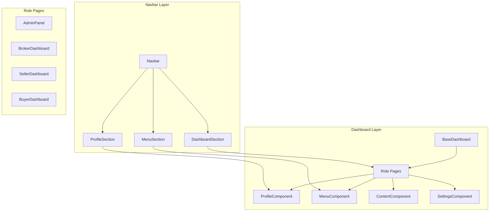

# Design Document: Dashboard Component Separation

## Overview

This design document outlines the technical implementation for separating navigation and dashboard components in the EthioDelala marketplace application. The current architecture suffers from poor separation of concerns where profile information, navigation menu items, and dashboard access are mixed together in a single dropdown menu. Additionally, dashboard pages have components mixed together rather than being properly separated into reusable components.

The solution involves:
1. **Navbar Navigation Separation**: Splitting the current mixed dropdown into distinct Profile Section, Menu Section, and Dashboard Section
2. **Dashboard Component Separation**: Extracting reusable Profile, Menu, Content, and Settings components from existing dashboard pages
3. **Component Composition Architecture**: Implementing a modular system where Role Pages compose separated components

This separation will improve user experience, code maintainability, and enable better testing while preserving all existing functionality.

## Architecture

### Current Architecture Issues

The existing system has several architectural problems:

1. **Mixed Concerns in Navbar**: The current dropdown mixes profile management, content navigation, and dashboard access
2. **Monolithic Dashboard Pages**: Each dashboard page (AdminPanel, BrokerDashboard, etc.) contains mixed responsibilities
3. **Code Duplication**: Similar functionality is repeated across different dashboard implementations
4. **Poor Testability**: Tightly coupled components make unit testing difficult

### Proposed Architecture

The new architecture follows a component composition pattern with clear separation of concerns:



### Component Hierarchy

```
Navbar
├── ProfileSection (user info + profile settings)
├── MenuSection (my listings, messages, transactions)
└── DashboardSection (direct dashboard access)

Role Pages (AdminPanel, BrokerDashboard, etc.)
├── BaseDashboard (existing wrapper)
├── ProfileComponent (reusable profile display)
├── MenuComponent (reusable navigation)
├── ContentComponent (role-specific content)
└── SettingsComponent (role-specific settings)
```

## Components and Interfaces

### Navbar Components

#### ProfileSection Component

**Purpose**: Displays user profile information and provides access to profile settings

**Interface**:
```typescript
interface ProfileSectionProps {
  user: User;
  onEditProfile: () => void;
  className?: string;
}

interface User {
  _id: string;
  fullName: string;
  role: 'admin' | 'broker' | 'seller' | 'buyer';
  avatar?: string;
  isVerified: boolean;
}
```

**Responsibilities**:
- Display user name, role, avatar, and verification status
- Provide "Edit Profile" functionality
- Handle role-specific profile elements
- Maintain visual distinction from navigation items

#### MenuSection Component

**Purpose**: Provides navigation to user content and activities

**Interface**:
```typescript
interface MenuSectionProps {
  user: User;
  unreadCounts?: {
    messages: number;
    notifications: number;
  };
  className?: string;
}
```

**Responsibilities**:
- Display "My Listings", "Messages", and "Transactions" navigation
- Show unread counts and notifications
- Apply role-based access control for menu items
- Provide consistent styling across all roles

#### DashboardSection Component

**Purpose**: Provides direct access to role-specific dashboards

**Interface**:
```typescript
interface DashboardSectionProps {
  user: User;
  className?: string;
}
```

**Responsibilities**:
- Determine appropriate dashboard based on user role
- Provide direct navigation without dropdown menus
- Handle role-aware routing
- Maintain visual distinction from other sections

### Dashboard Components

#### ProfileComponent

**Purpose**: Reusable component for displaying user profile information within dashboards

**Interface**:
```typescript
interface ProfileComponentProps {
  user: User;
  showEditButton?: boolean;
  showRoleInfo?: boolean;
  compact?: boolean;
  onEditProfile?: () => void;
}
```

**Responsibilities**:
- Display user profile information in dashboard context
- Handle different display modes (compact, full)
- Provide profile editing capabilities
- Show role-specific profile elements

#### MenuComponent

**Purpose**: Reusable navigation component for dashboard contexts

**Interface**:
```typescript
interface MenuComponentProps {
  user: User;
  currentPage?: string;
  showCounts?: boolean;
  orientation?: 'horizontal' | 'vertical';
}
```

**Responsibilities**:
- Provide navigation within dashboard context
- Show current page highlighting
- Display activity counts
- Support different orientations

#### ContentComponent

**Purpose**: Role-specific dashboard content display

**Interface**:
```typescript
interface ContentComponentProps {
  role: UserRole;
  data: DashboardData;
  loading?: boolean;
  error?: string;
  onRefresh?: () => void;
}

interface DashboardData {
  metrics: Record<string, number>;
  recentActivity: Activity[];
  charts?: ChartData[];
  tables?: TableData[];
}
```

**Responsibilities**:
- Display role-specific metrics and charts
- Handle data fetching and state management
- Provide loading states and error handling
- Support data refresh functionality

#### SettingsComponent

**Purpose**: Role-specific configuration options within dashboards

**Interface**:
```typescript
interface SettingsComponentProps {
  role: UserRole;
  settings: UserSettings;
  onSettingsChange: (settings: Partial<UserSettings>) => void;
  permissions: Permission[];
}

interface UserSettings {
  notifications: NotificationSettings;
  privacy: PrivacySettings;
  preferences: UserPreferences;
}
```

**Responsibilities**:
- Display role-appropriate configuration options
- Handle settings persistence and validation
- Communicate changes to other components
- Provide consistent styling across roles

## Data Models

### User Model Extensions

```typescript
interface User {
  _id: string;
  fullName: string;
  phone: string;
  role: 'admin' | 'broker' | 'seller' | 'buyer';
  avatar?: string;
  isVerified: boolean;
  isActive: boolean;
  settings: UserSettings;
  permissions: Permission[];
  createdAt: Date;
  updatedAt: Date;
}
```

### Dashboard Data Models

```typescript
interface DashboardData {
  user: User;
  metrics: DashboardMetrics;
  recentActivity: Activity[];
  notifications: Notification[];
  quickActions: QuickAction[];
}

interface DashboardMetrics {
  [key: string]: {
    value: number | string;
    change?: number;
    trend?: 'up' | 'down' | 'stable';
  };
}

interface Activity {
  id: string;
  type: 'listing' | 'message' | 'transaction' | 'system';
  description: string;
  timestamp: Date;
  metadata?: Record<string, any>;
}

interface QuickAction {
  label: string;
  icon: string;
  variant: string;
  onClick: () => void;
  disabled?: boolean;
}
```

### Component State Models

```typescript
interface NavigationState {
  activeSection: 'profile' | 'menu' | 'dashboard' | null;
  dropdownOpen: boolean;
  unreadCounts: {
    messages: number;
    notifications: number;
  };
}

interface DashboardState {
  loading: boolean;
  error: string | null;
  data: DashboardData | null;
  refreshing: boolean;
  lastRefresh: Date | null;
}
```
## Implementation Strategy

### Phase 1: Navbar Component Separation

#### Step 1: Extract ProfileSection
- Create `frontend/src/components/navbar/ProfileSection.jsx`
- Move profile-related dropdown items from existing Navbar
- Implement user info display and profile settings access
- Add role-aware profile elements

#### Step 2: Extract MenuSection  
- Create `frontend/src/components/navbar/MenuSection.jsx`
- Move navigation items (My Listings, Messages, Transactions) from dropdown
- Implement role-based menu filtering
- Add unread count displays

#### Step 3: Extract DashboardSection
- Create `frontend/src/components/navbar/DashboardSection.jsx`
- Implement direct dashboard access based on user role
- Remove dashboard links from dropdown menu
- Add role-aware routing logic

#### Step 4: Update Navbar Component
- Refactor existing Navbar to use new sections
- Replace mixed dropdown with separated sections
- Maintain existing styling and responsive behavior
- Preserve all current functionality

### Phase 2: Dashboard Component Separation

#### Step 1: Create Base Dashboard Components
- Create `frontend/src/components/dashboard/ProfileComponent.jsx`
- Create `frontend/src/components/dashboard/MenuComponent.jsx`
- Create `frontend/src/components/dashboard/ContentComponent.jsx`
- Create `frontend/src/components/dashboard/SettingsComponent.jsx`

#### Step 2: Extract Content from Existing Dashboards
- Analyze AdminPanel, BrokerDashboard, SellerDashboard, BuyerDashboard
- Extract common patterns into ContentComponent variants
- Create role-specific ContentComponent implementations
- Preserve all existing data fetching and state management

#### Step 3: Extract Settings Functionality
- Identify settings-related code in each dashboard
- Create role-specific SettingsComponent implementations
- Implement settings persistence and validation
- Maintain existing settings functionality

#### Step 4: Refactor Role Pages
- Update each dashboard page to use component composition
- Replace inline implementations with reusable components
- Maintain BaseDashboard wrapper functionality
- Preserve all existing features and styling

### Phase 3: Integration and Testing

#### Step 1: Component Integration
- Integrate navbar sections with dashboard components
- Implement cross-component communication
- Test role-based behavior across all components
- Verify responsive design and accessibility

#### Step 2: Data Flow Optimization
- Optimize data fetching patterns
- Implement efficient state management
- Add proper error handling and loading states
- Ensure consistent user experience

#### Step 3: Testing and Validation
- Unit test individual components
- Integration test component composition
- Validate role-based access control
- Test responsive behavior and edge cases

## File Structure

### New Component Organization

```
frontend/src/components/
├── navbar/
│   ├── ProfileSection.jsx
│   ├── MenuSection.jsx
│   ├── DashboardSection.jsx
│   └── index.js
├── dashboard/
│   ├── ProfileComponent.jsx
│   ├── MenuComponent.jsx
│   ├── ContentComponent.jsx
│   ├── SettingsComponent.jsx
│   └── index.js
└── Navbar.jsx (updated)
```

### Dashboard Page Updates

```
frontend/src/pages/
├── AdminPanel.jsx (refactored)
├── BrokerDashboard.jsx (refactored)
├── SellerDashboard.jsx (refactored)
├── BuyerDashboard.jsx (refactored)
└── ...
```

### Shared Utilities

```
frontend/src/utils/
├── roleUtils.js (role-based logic)
├── dashboardUtils.js (dashboard helpers)
└── navigationUtils.js (navigation helpers)
```

## Role-Based Behavior

### Profile Section Behavior

**All Roles**:
- Display user name, avatar, verification status
- Provide "Edit Profile" access
- Show role badge

**Admin**:
- Additional system status indicators
- Quick access to admin settings

**Broker**:
- Subscription status indicator
- Premium features badge

**Seller**:
- Listing count indicator
- Performance metrics preview

**Buyer**:
- Saved searches count
- Favorites count indicator

### Menu Section Behavior

**All Roles**:
- Messages (with unread count)
- Transactions/Payment History

**Admin**:
- User Management
- System Reports
- Analytics Dashboard

**Broker/Seller**:
- My Listings
- Analytics
- Subscription Management (Broker only)

**Buyer**:
- Saved Searches
- Favorited Listings
- Purchase History

### Dashboard Section Behavior

**Role-Based Routing**:
- Admin → `/admin-panel`
- Broker → `/broker-dashboard`
- Seller → `/seller-dashboard`
- Buyer → `/buyer-dashboard`

**Access Control**:
- Verify user permissions before routing
- Handle role changes gracefully
- Provide fallback for unauthorized access

## Component Communication

### Navbar to Dashboard Communication

```typescript
// Context for sharing navigation state
interface NavigationContextType {
  activeSection: string;
  setActiveSection: (section: string) => void;
  unreadCounts: UnreadCounts;
  updateUnreadCounts: (counts: Partial<UnreadCounts>) => void;
}
```

### Dashboard Component Communication

```typescript
// Props drilling for component composition
interface DashboardCompositionProps {
  user: User;
  dashboardData: DashboardData;
  onDataChange: (data: Partial<DashboardData>) => void;
  onSettingsChange: (settings: Partial<UserSettings>) => void;
}
```

### Event System

```typescript
// Custom events for cross-component communication
interface DashboardEvents {
  'profile-updated': { user: User };
  'settings-changed': { settings: UserSettings };
  'data-refreshed': { timestamp: Date };
  'navigation-changed': { section: string };
}
```

## Styling and Responsive Design

### CSS Architecture

```scss
// Component-specific styles
.profile-section {
  // Profile section styles
}

.menu-section {
  // Menu section styles
}

.dashboard-section {
  // Dashboard section styles
}

.dashboard-component {
  // Base dashboard component styles
  
  &.profile-component {
    // Profile component specific styles
  }
  
  &.content-component {
    // Content component specific styles
  }
  
  &.settings-component {
    // Settings component specific styles
  }
}
```

### Responsive Behavior

**Mobile (< 768px)**:
- Stack navbar sections vertically in dropdown
- Collapse dashboard components to single column
- Prioritize essential information

**Tablet (768px - 1024px)**:
- Horizontal navbar with condensed sections
- Two-column dashboard layout
- Maintain full functionality

**Desktop (> 1024px)**:
- Full horizontal navbar layout
- Multi-column dashboard grid
- Enhanced visual hierarchy

## Performance Considerations

### Code Splitting

```typescript
// Lazy load dashboard components
const ProfileComponent = lazy(() => import('./dashboard/ProfileComponent'));
const ContentComponent = lazy(() => import('./dashboard/ContentComponent'));
const SettingsComponent = lazy(() => import('./dashboard/SettingsComponent'));
```

### Memoization Strategy

```typescript
// Memoize expensive computations
const MemoizedContentComponent = memo(ContentComponent, (prevProps, nextProps) => {
  return prevProps.data === nextProps.data && prevProps.loading === nextProps.loading;
});
```

### Data Fetching Optimization

```typescript
// Implement efficient data fetching
const useDashboardData = (role: UserRole) => {
  return useQuery(['dashboard', role], () => fetchDashboardData(role), {
    staleTime: 5 * 60 * 1000, // 5 minutes
    cacheTime: 10 * 60 * 1000, // 10 minutes
  });
};
```

## Migration Strategy

### Backward Compatibility

1. **Gradual Migration**: Implement new components alongside existing ones
2. **Feature Flags**: Use feature flags to toggle between old and new implementations
3. **Fallback Handling**: Provide fallbacks for any missing functionality
4. **Data Compatibility**: Ensure new components work with existing data structures

### Testing Strategy

1. **Component Testing**: Unit test each new component in isolation
2. **Integration Testing**: Test component composition and interaction
3. **Visual Regression Testing**: Ensure UI consistency during migration
4. **User Acceptance Testing**: Validate user experience improvements

### Rollout Plan

1. **Phase 1**: Deploy navbar separation (low risk)
2. **Phase 2**: Deploy dashboard components (medium risk)
3. **Phase 3**: Full integration and cleanup (high impact)
4. **Phase 4**: Remove legacy code and optimize

## Error Handling and Edge Cases

### Component Error Boundaries

```typescript
class DashboardErrorBoundary extends Component {
  constructor(props) {
    super(props);
    this.state = { hasError: false, error: null };
  }

  static getDerivedStateFromError(error) {
    return { hasError: true, error };
  }

  componentDidCatch(error, errorInfo) {
    console.error('Dashboard component error:', error, errorInfo);
    // Log to error reporting service
  }

  render() {
    if (this.state.hasError) {
      return <DashboardErrorFallback error={this.state.error} />;
    }
    return this.props.children;
  }
}
```

### Loading States

```typescript
// Consistent loading states across components
const LoadingState = ({ type = 'default' }) => {
  const loadingTypes = {
    default: <Spinner />,
    skeleton: <SkeletonLoader />,
    minimal: <div>Loading...</div>
  };
  
  return loadingTypes[type];
};
```

### Error Recovery

```typescript
// Graceful error recovery
const useErrorRecovery = () => {
  const [error, setError] = useState(null);
  
  const retry = useCallback(() => {
    setError(null);
    // Retry failed operation
  }, []);
  
  const handleError = useCallback((error) => {
    setError(error);
    // Log error for monitoring
  }, []);
  
  return { error, retry, handleError };
};
```
## Correctness Properties

*A property is a characteristic or behavior that should hold true across all valid executions of a system-essentially, a formal statement about what the system should do. Properties serve as the bridge between human-readable specifications and machine-verifiable correctness guarantees.*

After analyzing the acceptance criteria, I identified several redundant properties that can be consolidated:

**Property Reflection:**
- Properties about role-aware behavior (1.5, 2.4, 3.3, 4.3, 8.1-8.5) can be consolidated into comprehensive role-awareness properties
- Properties about component existence and rendering (2.1, 3.1, 5.1, 6.1) can be combined into component composition properties  
- Properties about functionality preservation (7.5, 9.1-9.5) can be consolidated into backward compatibility properties
- Properties about visual distinction (2.5, 3.5, 4.5) are not testable and will be excluded
- Properties about component interfaces and testability (10.1-10.5) can be combined into component design properties

### Property 1: Navigation Section Separation

*For any* user accessing the navbar, the navigation system should contain distinct ProfileSection and MenuSection components instead of a mixed dropdown menu.

**Validates: Requirements 1.1, 7.1**

### Property 2: Profile Section Content Display

*For any* user role, when the ProfileSection renders, it should display the user's name, role, avatar, verification status, and provide edit profile functionality.

**Validates: Requirements 1.2, 2.1, 2.2, 2.3**

### Property 3: Menu Section Navigation Access

*For any* user accessing the MenuSection, the system should provide navigation options for "My Listings", "Messages", and "Transactions" appropriate to their role and permissions.

**Validates: Requirements 1.3, 3.1, 3.2**

### Property 4: Direct Dashboard Access

*For any* user role, dashboard access should be provided directly without requiring navigation through dropdown menus.

**Validates: Requirements 1.4, 4.1, 4.2**

### Property 5: Role-Aware Component Behavior

*For any* user role and any component (ProfileSection, MenuSection, DashboardSection, ContentComponent, SettingsComponent), the component should display content and options appropriate to that user's role and permissions.

**Validates: Requirements 1.5, 2.4, 3.3, 4.3, 8.1, 8.2, 8.3, 8.4, 8.5**

### Property 6: Dashboard Component Composition

*For any* role page, when the page renders, it should compose ContentComponent and SettingsComponent with role-specific props and configuration while maintaining BaseDashboard layout functionality.

**Validates: Requirements 5.1, 5.2, 6.1, 6.2, 7.2, 7.3, 7.4**

### Property 7: Component Data Management

*For any* ContentComponent instance, the component should handle its own data fetching, state management, loading states, and error handling for role-specific content.

**Validates: Requirements 5.3, 5.4**

### Property 8: Settings Component Functionality

*For any* SettingsComponent instance, the component should handle settings persistence, validation, and communicate changes to other components when settings affect them.

**Validates: Requirements 6.3, 6.4**

### Property 9: Component Composability

*For any* dashboard component (ProfileComponent, MenuComponent, ContentComponent, SettingsComponent), the component should be composable with other dashboard components and provide consistent behavior across all roles.

**Validates: Requirements 3.4, 5.5, 6.5**

### Property 10: Functionality Preservation

*For any* existing user workflow or feature, after component separation, the system should provide equivalent or improved functionality while maintaining all existing data operations, state management, and user interactions.

**Validates: Requirements 4.4, 7.5, 9.1, 9.2, 9.3, 9.5**

### Property 11: Responsive Behavior Preservation

*For any* screen size or device type, the separated components should maintain existing responsive behavior and visual layout patterns.

**Validates: Requirements 9.4**

### Property 12: Component Modularity

*For any* separated component, the component should be importable and usable independently, have clear prop interfaces, enable unit testing, and follow React best practices for component design.

**Validates: Requirements 10.1, 10.2, 10.3, 10.5**

### Property 13: Component Reusability

*For any* appropriate context, separated components should be reusable across different parts of the application while maintaining their core functionality.

**Validates: Requirements 10.4**

## Error Handling

### Component Error Boundaries

Each major component section will be wrapped with error boundaries to prevent cascading failures:

```typescript
// Navbar error boundary
<NavbarErrorBoundary>
  <ProfileSection />
  <MenuSection />
  <DashboardSection />
</NavbarErrorBoundary>

// Dashboard error boundary
<DashboardErrorBoundary>
  <ContentComponent />
  <SettingsComponent />
</DashboardErrorBoundary>
```

### Graceful Degradation

Components will implement graceful degradation strategies:

1. **Profile Section**: Falls back to basic user info if avatar/verification fails to load
2. **Menu Section**: Shows core navigation even if counts/badges fail to load
3. **Content Component**: Shows basic metrics if advanced charts fail to render
4. **Settings Component**: Provides essential settings even if advanced options fail

### Error Recovery Mechanisms

```typescript
// Automatic retry for failed data fetching
const useRetryableData = (fetchFn, maxRetries = 3) => {
  const [data, setData] = useState(null);
  const [error, setError] = useState(null);
  const [retryCount, setRetryCount] = useState(0);
  
  const fetchData = useCallback(async () => {
    try {
      const result = await fetchFn();
      setData(result);
      setError(null);
      setRetryCount(0);
    } catch (err) {
      if (retryCount < maxRetries) {
        setRetryCount(prev => prev + 1);
        setTimeout(fetchData, 1000 * Math.pow(2, retryCount)); // Exponential backoff
      } else {
        setError(err);
      }
    }
  }, [fetchFn, retryCount, maxRetries]);
  
  return { data, error, retry: fetchData };
};
```

### Fallback Components

```typescript
// Fallback components for critical failures
const ProfileSectionFallback = ({ user }) => (
  <div className="profile-section-fallback">
    <span>{user?.fullName || 'User'}</span>
    <Link to="/profile">Profile</Link>
  </div>
);

const MenuSectionFallback = ({ user }) => (
  <div className="menu-section-fallback">
    <Link to="/my-listings">Listings</Link>
    <Link to="/messages">Messages</Link>
  </div>
);
```

## Testing Strategy

### Dual Testing Approach

The testing strategy combines unit tests for specific functionality with property-based tests for comprehensive coverage:

**Unit Tests**:
- Component rendering with different props
- User interaction handling (clicks, form submissions)
- Error boundary behavior
- Responsive design breakpoints
- Role-based access control edge cases

**Property-Based Tests**:
- Role-aware behavior across all user roles
- Component composition with various configurations
- Data flow and state management consistency
- Navigation behavior across different user states
- Backward compatibility with existing functionality

### Property-Based Testing Configuration

Each property test will be configured to run a minimum of 100 iterations using React Testing Library and Jest:

```typescript
// Example property test configuration
describe('Dashboard Component Separation Properties', () => {
  test('Property 5: Role-Aware Component Behavior', () => {
    fc.assert(fc.property(
      fc.record({
        role: fc.constantFrom('admin', 'broker', 'seller', 'buyer'),
        user: userGenerator,
        permissions: permissionsGenerator
      }),
      ({ role, user, permissions }) => {
        const { getByTestId } = render(
          <ProfileSection user={{ ...user, role }} permissions={permissions} />
        );
        
        // Test that component displays role-appropriate content
        const profileElement = getByTestId('profile-section');
        expect(profileElement).toBeInTheDocument();
        
        // Verify role-specific elements are present
        if (role === 'admin') {
          expect(getByTestId('admin-indicators')).toBeInTheDocument();
        }
        if (role === 'broker') {
          expect(getByTestId('subscription-status')).toBeInTheDocument();
        }
        // ... additional role-specific assertions
      }
    ), { numRuns: 100 });
  });
});
```

**Property Test Tags**:
- **Feature: dashboard-component-separation, Property 1**: Navigation section separation
- **Feature: dashboard-component-separation, Property 2**: Profile section content display
- **Feature: dashboard-component-separation, Property 3**: Menu section navigation access
- **Feature: dashboard-component-separation, Property 4**: Direct dashboard access
- **Feature: dashboard-component-separation, Property 5**: Role-aware component behavior
- **Feature: dashboard-component-separation, Property 6**: Dashboard component composition
- **Feature: dashboard-component-separation, Property 7**: Component data management
- **Feature: dashboard-component-separation, Property 8**: Settings component functionality
- **Feature: dashboard-component-separation, Property 9**: Component composability
- **Feature: dashboard-component-separation, Property 10**: Functionality preservation
- **Feature: dashboard-component-separation, Property 11**: Responsive behavior preservation
- **Feature: dashboard-component-separation, Property 12**: Component modularity
- **Feature: dashboard-component-separation, Property 13**: Component reusability

### Testing Tools and Libraries

**Primary Testing Stack**:
- **Jest**: Test runner and assertion library
- **React Testing Library**: Component testing utilities
- **fast-check**: Property-based testing library for JavaScript
- **MSW (Mock Service Worker)**: API mocking for integration tests
- **Storybook**: Component documentation and visual testing

**Testing Utilities**:
```typescript
// Custom generators for property-based testing
const userGenerator = fc.record({
  _id: fc.string(),
  fullName: fc.string(),
  role: fc.constantFrom('admin', 'broker', 'seller', 'buyer'),
  isVerified: fc.boolean(),
  avatar: fc.option(fc.webUrl())
});

const dashboardDataGenerator = fc.record({
  metrics: fc.dictionary(fc.string(), fc.integer()),
  recentActivity: fc.array(activityGenerator),
  notifications: fc.array(notificationGenerator)
});
```

### Integration Testing

Integration tests will verify component interaction and data flow:

```typescript
// Integration test example
test('Navbar sections communicate with dashboard components', async () => {
  const user = { role: 'seller', fullName: 'Test Seller' };
  
  render(
    <Router>
      <NavigationProvider>
        <Navbar />
        <SellerDashboard />
      </NavigationProvider>
    </Router>
  );
  
  // Test navigation from navbar to dashboard
  fireEvent.click(screen.getByTestId('dashboard-section-link'));
  
  await waitFor(() => {
    expect(screen.getByTestId('seller-dashboard')).toBeInTheDocument();
  });
  
  // Verify dashboard components are properly composed
  expect(screen.getByTestId('content-component')).toBeInTheDocument();
  expect(screen.getByTestId('settings-component')).toBeInTheDocument();
});
```

This comprehensive testing strategy ensures that the component separation maintains all existing functionality while improving code organization and user experience.