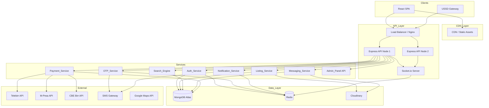

# Design Document: EthioDelala Marketplace

## Overview

EthioDelala is a full-stack MERN marketplace that digitizes the traditional Ethiopian "Delala" (broker/intermediary) system. The platform connects Buyers, Sellers, and professional Brokers for real estate and automotive listings across Ethiopia.

**Phase 1 scope:** Real estate and automotive listings, nationwide Ethiopia coverage, web application only.

**Core capabilities:**
- Multi-role user accounts (Buyer, Seller, Broker, Administrator) with phone-based OTP verification and National ID identity checks
- Listing lifecycle management with category-specific fields, media uploads, and auto-expiry
- Full-text and geo-radius search with Ethiopian region filtering
- Real-time Socket.io messaging with privacy protection
- Ethiopian payment gateway integration (Telebirr, M-Pesa, CBE Birr) with escrow
- Premium Broker subscriptions with featured listings and analytics
- Administrative back-office for moderation, user management, and reporting
- Amharic/English multilingual UI
- USSD access for feature-phone users

**Technology stack:**
- Frontend: React 19 (Vite), Bootstrap 5, Axios, React Router v6, Redux Toolkit
- Backend: Node.js, Express 5, Socket.io, JWT, bcrypt, Multer
- Database: MongoDB (Mongoose ODM), MongoDB Atlas
- Caching: Redis (session store, OTP store, rate limiting)
- Storage: Cloudinary (images/videos)
- Maps: Google Maps API (geo-radius search)
- SMS/USSD: Ethiopian telecom integration (Ethio Telecom API)
- Payments: Telebirr API, M-Pesa API, CBE Birr API
- Testing: Jest + Supertest (unit/integration), fast-check (property-based)

---

## Architecture

The system follows a layered monolith-first architecture with clear service boundaries, designed for horizontal scaling of the API layer.



**Key architectural decisions:**

- **Stateless API nodes** — JWT access tokens carry identity; refresh tokens stored in Redis for revocation. This enables horizontal scaling without sticky sessions.
- **Redis as shared state** — OTP codes, rate-limit counters, Socket.io adapter (pub/sub across nodes), and notification queues all use Redis so any API node can serve any request.
- **MongoDB Atlas** — Managed cloud MongoDB with replica sets for high availability and built-in geo-index support for radius search.
- **Cloudinary** — Handles image/video transformation, CDN delivery, and storage, removing that concern from the API.
- **Socket.io with Redis adapter** — Allows real-time events to be broadcast across multiple API nodes.

---

## Components and Interfaces

### Auth_Service

Handles registration, login, token lifecycle, RBAC, and account status.

```
POST /api/auth/register          — Guest registration
POST /api/auth/verify-otp        — Phone OTP verification
POST /api/auth/login             — Credential login → JWT pair
POST /api/auth/refresh           — Rotate refresh token
POST /api/auth/logout            — Revoke refresh token
POST /api/auth/forgot-password   — Send password-reset OTP
POST /api/auth/reset-password    — Apply new password
GET  /api/auth/me                — Current user profile (protected)
```

RBAC middleware reads the `role` claim from the JWT and compares it against a route-level permission list. Roles: `guest`, `buyer`, `seller`, `broker`, `admin`.

Account lockout: after 5 failed logins from the same IP within a 15-minute window (tracked in Redis), the IP is blocked for 15 minutes.

### OTP_Service

Generates cryptographically random 6-digit OTPs, stores them in Redis with TTL, and dispatches SMS via the Ethiopian telecom gateway.

- Registration OTP TTL: 24 hours (Req 2.1, 2.3)
- Password-reset OTP TTL: 15 minutes (Req 6.3)
- Resend invalidates previous OTP by overwriting the Redis key (Req 2.4)

### Listing_Service

```
POST   /api/listings                    — Create listing (Seller/Broker)
GET    /api/listings/:id                — Get listing detail (public)
PUT    /api/listings/:id                — Update listing (owner)
DELETE /api/listings/:id                — Delete listing (owner)
PATCH  /api/listings/:id/status         — Activate / deactivate / renew
GET    /api/listings/my                 — Owner's listings (authenticated)
```

Category-specific field validation is driven by the Category document (Req 21), making it extensible without code changes.

Auto-expiry: a scheduled job (node-cron) runs daily, finds listings where `expiresAt < now` and status is `active`, sets them to `expired`, and enqueues expiry notifications.

### Search_Engine

```
GET /api/search?q=&category=&minPrice=&maxPrice=&region=&lat=&lng=&radius=
GET /api/search/saved              — List saved searches (authenticated)
POST /api/search/saved             — Save a search query
DELETE /api/search/saved/:id       — Delete saved search
```

Uses MongoDB text indexes for keyword search and `$geoWithin` / `$centerSphere` for radius queries. Featured listings are boosted to the top of each relevance tier via a sort stage.

### Messaging_Service

```
POST /api/conversations                 — Start conversation (links to listing)
GET  /api/conversations                 — List user's conversations
GET  /api/conversations/:id/messages    — Paginated message history
POST /api/conversations/:id/messages    — Send message (REST fallback)
POST /api/users/:id/block               — Block user
DELETE /api/users/:id/block             — Unblock user
```

Socket.io events:
- `message:send` — client emits; server persists and broadcasts to room
- `message:receive` — server emits to recipient's socket room
- `conversation:typing` — typing indicator
- `notification:new` — general notification push

Offline queuing: messages are persisted to MongoDB regardless of recipient online status. On reconnect, the client fetches unread messages via REST.

### Payment_Service

```
POST /api/payments/initiate             — Start payment (Buyer)
POST /api/payments/webhook/:gateway     — Gateway callback (Telebirr/M-Pesa/CBE)
GET  /api/payments/:id/receipt          — Download receipt
GET  /api/payments/history              — User transaction history
POST /api/escrow/initiate               — Start escrow payment
POST /api/escrow/:id/confirm            — Buyer/Seller confirm completion
POST /api/escrow/:id/dispute            — Raise dispute
POST /api/admin/payments/:id/manual     — Admin manual verification
```

Commission calculation is a configurable percentage stored in a `PlatformConfig` document. Receipts are generated as JSON (downloadable as PDF via client-side rendering).

### Notification_Service

Runs as an internal module (not a separate process in Phase 1). Triggered by events from other services. Persists in-app notifications to MongoDB and dispatches SMS via the telecom gateway for payment and verification events.

### Admin_Panel API

```
GET    /api/admin/users                 — Paginated user list with search
PATCH  /api/admin/users/:id/suspend     — Suspend account
PATCH  /api/admin/users/:id/reinstate   — Reinstate account
DELETE /api/admin/users/:id             — Anonymize account
GET    /api/admin/verifications         — Pending ID/license queue
PATCH  /api/admin/verifications/:id     — Approve/reject verification
GET    /api/admin/reports               — Moderation report queue
PATCH  /api/admin/reports/:id           — Take action on report
GET    /api/admin/analytics             — Platform dashboard metrics
GET    /api/admin/analytics/export      — CSV export
GET    /api/admin/categories            — Category list
POST   /api/admin/categories            — Create category
PUT    /api/admin/categories/:id        — Update category
PATCH  /api/admin/categories/:id/status — Activate/deactivate category
```

---

## Data Models

### User

```javascript
{
  _id: ObjectId,
  phone: String,          // unique, Ethiopian format
  fullName: String,
  passwordHash: String,   // bcrypt, cost 12
  role: enum['buyer','seller','broker','admin'],
  isPhoneVerified: Boolean,
  verificationStatus: enum['none','pending','verified','rejected'],
  verificationDoc: String,        // Cloudinary URL
  businessLicense: String,        // Cloudinary URL (brokers)
  profilePhoto: String,           // Cloudinary URL
  location: String,
  bio: String,
  preferredLanguage: enum['en','am'],
  isActive: Boolean,              // false = suspended
  blockedUsers: [ObjectId],       // ref: User
  premiumSubscription: {
    isActive: Boolean,
    plan: String,
    startDate: Date,
    renewalDate: Date,
    paymentMethod: String,
    cancelAtRenewal: Boolean
  },
  loginAttempts: Number,
  lockUntil: Date,
  createdAt: Date,
  updatedAt: Date
}
```

Indexes: `{ phone: 1 }` unique; `{ role: 1 }`.

### Listing

```javascript
{
  _id: ObjectId,
  owner: ObjectId,        // ref: User
  title: String,
  description: String,
  category: ObjectId,     // ref: Category
  categorySlug: enum['real-estate','automotive'],
  price: Number,
  currency: String,       // default 'ETB'
  location: {
    region: String,       // Ethiopian region
    city: String,
    address: String,
    coordinates: {
      type: 'Point',
      coordinates: [Number, Number]  // [lng, lat]
    }
  },
  images: [String],       // Cloudinary URLs
  video: String,          // Cloudinary URL
  status: enum['active','inactive','expired','removed'],
  isFeatured: Boolean,
  viewCount: Number,
  uniqueViewers: [ObjectId],
  expiresAt: Date,        // createdAt + 30 days, reset on renewal
  // Real estate fields
  realEstate: {
    propertyType: String,
    sizeSqm: Number,
    bedrooms: Number,
    bathrooms: Number,
    furnishingStatus: enum['furnished','semi-furnished','unfurnished']
  },
  // Automotive fields
  automotive: {
    make: String,
    model: String,
    year: Number,
    mileage: Number,
    fuelType: String,
    transmission: enum['manual','automatic']
  },
  // Dynamic fields for future categories
  customFields: Map,
  createdAt: Date,
  updatedAt: Date
}
```

Indexes: `{ location.coordinates: '2dsphere' }`; text index on `{ title: 'text', description: 'text' }`; `{ status: 1, isFeatured: -1, createdAt: -1 }`; `{ owner: 1 }`.

### Conversation & Message

```javascript
// Conversation
{
  _id: ObjectId,
  listing: ObjectId,      // ref: Listing
  participants: [ObjectId], // ref: User
  lastMessage: ObjectId,  // ref: Message
  createdAt: Date,
  updatedAt: Date
}

// Message
{
  _id: ObjectId,
  conversation: ObjectId, // ref: Conversation
  sender: ObjectId,       // ref: User
  body: String,
  attachment: String,     // Cloudinary URL
  isRead: Boolean,
  createdAt: Date
}
```

Indexes: `{ conversation: 1, createdAt: -1 }`; `{ participants: 1 }`.

### Transaction

```javascript
{
  _id: ObjectId,
  buyer: ObjectId,        // ref: User
  seller: ObjectId,       // ref: User
  listing: ObjectId,      // ref: Listing
  amount: Number,
  commission: Number,
  netAmount: Number,
  currency: String,
  gateway: enum['telebirr','mpesa','cbe-birr'],
  gatewayRef: String,
  status: enum['pending','completed','failed','escrowed','disputed','released'],
  isEscrow: Boolean,
  escrow: {
    buyerConfirmed: Boolean,
    sellerConfirmed: Boolean,
    autoReleaseAt: Date,
    frozenAt: Date
  },
  receipt: {
    generatedAt: Date,
    url: String
  },
  createdAt: Date,
  updatedAt: Date
}
```

Indexes: `{ buyer: 1 }`; `{ seller: 1 }`; `{ status: 1 }`; `{ createdAt: -1 }`.

### Dispute

```javascript
{
  _id: ObjectId,
  transaction: ObjectId,  // ref: Transaction
  raisedBy: ObjectId,     // ref: User
  against: ObjectId,      // ref: User
  reason: String,
  evidence: [{
    submittedBy: ObjectId,
    text: String,
    fileUrl: String,
    submittedAt: Date
  }],
  status: enum['open','resolved'],
  resolution: {
    resolvedBy: ObjectId, // ref: User (admin)
    outcome: String,
    resolvedAt: Date
  },
  createdAt: Date
}
```

### Notification

```javascript
{
  _id: ObjectId,
  recipient: ObjectId,    // ref: User
  type: String,           // 'message','offer','payment','verification','expiry'
  title: String,
  body: String,
  isRead: Boolean,
  relatedId: ObjectId,    // polymorphic ref
  relatedModel: String,
  createdAt: Date
}
```

Indexes: `{ recipient: 1, isRead: 1, createdAt: -1 }`.

### Category

```javascript
{
  _id: ObjectId,
  name: { en: String, am: String },
  slug: String,           // unique
  requiredFields: [{
    key: String,
    label: { en: String, am: String },
    type: enum['string','number','enum','boolean'],
    options: [String],    // for enum type
    required: Boolean
  }],
  isActive: Boolean,
  createdAt: Date,
  updatedAt: Date
}
```

### SavedSearch

```javascript
{
  _id: ObjectId,
  user: ObjectId,         // ref: User
  params: {
    q: String,
    category: String,
    minPrice: Number,
    maxPrice: Number,
    region: String,
    lat: Number,
    lng: Number,
    radius: Number
  },
  createdAt: Date
}
```

### ModerationReport

```javascript
{
  _id: ObjectId,
  reportedBy: ObjectId,   // ref: User
  targetType: enum['listing','message'],
  targetId: ObjectId,
  reason: String,
  status: enum['open','actioned','dismissed'],
  actionTaken: String,
  actionBy: ObjectId,     // ref: User (admin)
  createdAt: Date,
  updatedAt: Date
}
```

### ActivityLog

```javascript
{
  _id: ObjectId,
  user: ObjectId,         // ref: User
  event: String,          // 'login','listing_created','payment_initiated', etc.
  metadata: Object,
  createdAt: Date         // TTL index: 90 days
}
```

TTL index: `{ createdAt: 1 }` with `expireAfterSeconds: 7776000` (90 days).


---

## Correctness Properties

*A property is a characteristic or behavior that should hold true across all valid executions of a system — essentially, a formal statement about what the system should do. Properties serve as the bridge between human-readable specifications and machine-verifiable correctness guarantees.*

### Property 1: Registration validation rejects invalid inputs

*For any* registration payload missing one or more required fields (phone, fullName, password, role), or where the role is `broker` and no business license is provided, the Auth_Service should reject the request and identify each invalid or missing field in the error response.

**Validates: Requirements 1.3, 1.6**

---

### Property 2: Duplicate phone registration is rejected

*For any* phone number already associated with an existing account, a second registration attempt with that phone number should be rejected with a descriptive error.

**Validates: Requirements 1.2**

---

### Property 3: Under-18 registration is rejected

*For any* date of birth corresponding to an age under 18 years, the Auth_Service should reject the registration with an eligibility error.

**Validates: Requirements 1.4**

---

### Property 4: Passwords are stored as bcrypt hashes with cost factor ≥ 12

*For any* registered user, the stored password field should be a valid bcrypt hash whose cost factor is at least 12, and should never equal the plaintext password.

**Validates: Requirements 1.5**

---

### Property 5: OTP verification round-trip activates account

*For any* newly registered user, submitting the correct OTP within the validity window should mark the phone as verified and set the account to active; submitting an incorrect OTP should be rejected.

**Validates: Requirements 2.1, 2.2**

---

### Property 6: OTP resend invalidates previous OTP

*For any* user who requests an OTP resend, the previously issued OTP should no longer be accepted for verification after the resend.

**Validates: Requirements 2.4**

---

### Property 7: Unverified users are blocked from restricted actions

*For any* user whose phone is unverified, attempts to create a listing, send a message, or initiate a payment should be rejected with an authorization error.

**Validates: Requirements 2.5, 7.8**

---

### Property 8: National ID upload triggers pending status; admin review transitions state

*For any* valid National ID upload (JPEG/PNG, ≤ 5 MB), the user's verification status should become "pending". When an admin approves, it should become "verified"; when an admin rejects, it should become "rejected". Files exceeding 5 MB or in unsupported formats should be rejected.

**Validates: Requirements 3.1, 3.2, 3.3, 3.5**

---

### Property 9: Login returns correctly scoped JWT tokens

*For any* user with valid credentials, the login response should contain a JWT access token with a 15-minute expiry and a JWT refresh token with a 7-day expiry. Invalid credentials should return a generic error that does not reveal which field is wrong.

**Validates: Requirements 4.1, 4.2**

---

### Property 10: Refresh token rotation

*For any* valid, non-expired, non-revoked refresh token, presenting it to the refresh endpoint should return a new access token and a new refresh token, and the old refresh token should no longer be accepted.

**Validates: Requirements 4.3, 4.4**

---

### Property 11: Logout revokes refresh token

*For any* authenticated user who logs out, their refresh token should be revoked such that subsequent refresh attempts are rejected with an unauthorized error.

**Validates: Requirements 4.5**

---

### Property 12: RBAC enforces role-based endpoint access

*For any* API endpoint with a defined role requirement and any user whose role is not in the allowed set, the request should be rejected with a 403 Forbidden response.

**Validates: Requirements 4.6**

---

### Property 13: Profile update round-trip

*For any* valid profile update payload (display name, photo URL, location, bio), the API should persist the changes and the subsequent profile fetch should return the updated values.

**Validates: Requirements 5.1, 5.2**

---

### Property 14: Profile photo upload validation

*For any* file exceeding 2 MB or not in JPEG/PNG format, the profile photo upload should be rejected with a descriptive error.

**Validates: Requirements 5.3**

---

### Property 15: Password change round-trip

*For any* user, providing the correct current password and a new password should result in the new password being accepted for subsequent logins, and the old password being rejected. Providing an incorrect current password should be rejected.

**Validates: Requirements 5.4, 5.5**

---

### Property 16: Password recovery does not reveal account existence

*For any* phone number (registered or not), the password-recovery endpoint should return a response with the same structure and HTTP status code, preventing enumeration of registered accounts.

**Validates: Requirements 6.4**

---

### Property 17: Password reset OTP round-trip

*For any* registered user, submitting a valid reset OTP and a new password should update the password and invalidate the OTP so it cannot be reused.

**Validates: Requirements 6.2**

---

### Property 18: Listing creation with valid payload produces active listing

*For any* verified Seller or Broker submitting a listing with all required fields (including category-specific fields for real estate or automotive), the Listing_Service should persist the listing with status "active" and return the created listing object.

**Validates: Requirements 7.1, 7.2, 7.3**

---

### Property 19: Listing image upload validation

*For any* batch of images where some are valid (JPEG/PNG, ≤ 10 MB) and some are invalid (wrong format or oversized), the Listing_Service should store only the valid images and reject the invalid ones without discarding the already-uploaded valid images.

**Validates: Requirements 7.4, 7.5**

---

### Property 20: Duplicate listing detection

*For any* Seller or Broker who already has an active listing with a given title and price, submitting a new listing with the same title and price should trigger a duplicate warning in the response.

**Validates: Requirements 7.7**

---

### Property 21: Listing ownership authorization

*For any* listing and any user who is not the listing's owner, attempts to edit or delete the listing should be rejected with a 403 authorization error.

**Validates: Requirements 8.5**

---

### Property 22: Listing deactivate/reactivate round-trip

*For any* active listing, deactivating it should set status to "inactive" and exclude it from search results; subsequently reactivating it should set status back to "active" and include it in search results.

**Validates: Requirements 8.3, 8.4**

---

### Property 23: Listing deletion removes the listing

*For any* listing that is deleted by its owner, a subsequent fetch of that listing by ID should return a 404 response.

**Validates: Requirements 8.2**

---

### Property 24: Expired listing renewal restores active status

*For any* expired listing, renewing it should set the status back to "active" and reset the expiry timer to 30 days from the renewal date.

**Validates: Requirements 8.7**

---

### Property 25: Keyword search returns only matching active listings

*For any* keyword search query, all returned listings should have status "active" and their title or description should contain the keyword (case-insensitive).

**Validates: Requirements 9.1**

---

### Property 26: Filter search returns only listings satisfying all filters

*For any* combination of filters (category, price range, region, status), all returned listings should satisfy every applied filter simultaneously, and all returned listings should have status "active".

**Validates: Requirements 9.2, 9.6**

---

### Property 27: Geo-radius search returns listings within radius sorted by distance

*For any* geographic coordinate and radius, all returned listings should be located within that radius, and the result set should be sorted in ascending order of distance from the query coordinate.

**Validates: Requirements 9.3**

---

### Property 28: Saved search round-trip

*For any* search query parameters saved by a user, retrieving the user's saved searches should return a record containing those exact parameters.

**Validates: Requirements 9.4**

---

### Property 29: View count increments on listing detail fetch

*For any* listing, fetching its detail page should increment the listing's viewCount by exactly 1.

**Validates: Requirements 9.7**

---

### Property 30: Message persistence and retrieval

*For any* message sent in a conversation, the message should be persisted to the database and retrievable via the conversation's message history endpoint, regardless of whether the recipient is online at the time of sending.

**Validates: Requirements 10.2, 10.3**

---

### Property 31: Message privacy — no PII exposure

*For any* message payload returned by the API, the payload should not contain the sender's or recipient's phone number or email address unless the user has explicitly chosen to share it.

**Validates: Requirements 10.5**

---

### Property 32: Block prevents message delivery

*For any* blocking relationship where user A has blocked user B, any message sent by user B to user A should be silently discarded and not appear in user A's message history.

**Validates: Requirements 10.6, 10.7**

---

### Property 33: Notification created for relevant events

*For any* triggering event (new message, new offer, payment event, verification status change), the Notification_Service should create an in-app notification record for the affected user.

**Validates: Requirements 11.1, 11.2, 11.3, 11.5**

---

### Property 34: Commission invariant

*For any* completed transaction with amount A and commission rate R, the commission field should equal A × R and the netAmount field should equal A − commission, with no rounding errors beyond 2 decimal places.

**Validates: Requirements 12.3, 12.5**

---

### Property 35: Receipt completeness

*For any* completed transaction, the generated receipt should contain all required fields: transaction ID, amount, commission, net amount, timestamp, buyer identity, and seller identity.

**Validates: Requirements 12.6**

---

### Property 36: Escrow state transitions

*For any* escrow payment, initiating escrow should set transaction status to "escrowed"; both parties confirming should release funds and set status to "released"; raising a dispute should freeze funds and set status to "disputed".

**Validates: Requirements 13.1, 13.2, 13.4**

---

### Property 37: Dispute creation within eligibility window

*For any* completed transaction, raising a dispute within 14 days should create a dispute record linked to the transaction. Raising a dispute after 14 days should be rejected with an eligibility error.

**Validates: Requirements 14.1, 14.2**

---

### Property 38: Dispute evidence submission validation

*For any* dispute, submitting evidence with a file attachment exceeding 10 MB should be rejected; valid evidence (text or file ≤ 10 MB) should be accepted and associated with the dispute.

**Validates: Requirements 14.4**

---

### Property 39: Premium subscription activation

*For any* Broker who completes a subscription payment, the subscription should be immediately active, granting access to featuring up to 5 listings and analytics.

**Validates: Requirements 15.1, 15.2**

---

### Property 40: Subscription cancellation state

*For any* Broker who cancels their subscription at least 24 hours before the renewal date, the subscription should be marked for non-renewal and premium access should remain until the end of the current billing period.

**Validates: Requirements 15.4**

---

### Property 41: Subscription downgrade on payment failure

*For any* Broker whose renewal payment fails, the system should notify the Broker and downgrade the account to standard Broker access within 24 hours.

**Validates: Requirements 15.6**

---

### Property 42: Featured listing ordering invariant

*For any* search result set, featured listings should appear before non-featured listings within the same relevance tier.

**Validates: Requirements 16.2**

---

### Property 43: Inactive subscription prevents featuring

*For any* Broker whose subscription is inactive, attempts to mark a listing as featured should be rejected, and any existing featured listings should have their featured flag set to false.

**Validates: Requirements 16.3**

---

### Property 44: Analytics access control

*For any* Broker with an active subscription, the analytics endpoint should return per-listing and aggregate analytics containing all required fields (views, unique views, inquiries, offers). For any Broker whose subscription has expired, the analytics endpoint should return a 403 response.

**Validates: Requirements 17.1, 17.2, 17.3**

---

### Property 45: User suspension round-trip

*For any* user account, suspending it should prevent login; reinstating it should restore login capability.

**Validates: Requirements 18.2, 18.3**

---

### Property 46: Account anonymization preserves transaction records

*For any* deleted user account, all PII fields (name, phone, profile photo) should be replaced with anonymized placeholders, while transaction records referencing that user should remain intact.

**Validates: Requirements 18.4**

---

### Property 47: Admin user search returns matching records

*For any* admin search query (by phone, name, or ID), all returned user records should match the query criteria.

**Validates: Requirements 18.1**

---

### Property 48: Content moderation state transitions

*For any* listing flagged by an admin, the listing status should be set to "removed" and a notification should be created for the listing owner. For any user report, a moderation report record should be created.

**Validates: Requirements 19.1, 19.2, 19.3**

---

### Property 49: Analytics report date range correctness

*For any* admin report request with a specified date range, all data points in the report should fall within that date range.

**Validates: Requirements 20.2**

---

### Property 50: Category management lifecycle

*For any* newly created category, it should be immediately available for listing creation. Updating required fields should not affect existing listings. Deactivating a category should prevent new listings while existing listings remain visible.

**Validates: Requirements 21.1, 21.2, 21.3**

---

### Property 51: i18n key completeness

*For any* i18n translation key in the system, both the "en" and "am" translations should be present and non-empty.

**Validates: Requirements 23.1**

---

### Property 52: Language preference persistence

*For any* authenticated user who sets a preferred language, the subsequent profile fetch should return that language preference.

**Validates: Requirements 23.2**

---

### Property 53: Input sanitization rejects injection payloads

*For any* user-supplied input containing XSS payloads (e.g., `<script>` tags) or NoSQL injection patterns (e.g., `$where`, `$gt` operators in string fields), the API should sanitize or reject the input before processing or persisting.

**Validates: Requirements 24.2**

---

### Property 54: Account lockout after repeated failed logins

*For any* IP address that submits 5 consecutive failed login attempts within a 15-minute window, the 6th login attempt from that IP should be rejected with a lockout error for 15 minutes.

**Validates: Requirements 24.4**

---

### Property 55: Security headers present on all responses

*For any* API response, the response headers should include Content-Security-Policy, X-Frame-Options, X-Content-Type-Options, and Strict-Transport-Security.

**Validates: Requirements 24.5**

---

## Error Handling

### HTTP Status Code Conventions

| Scenario | Status Code |
|---|---|
| Validation failure (missing/invalid fields) | 400 Bad Request |
| Authentication failure (wrong credentials, expired token) | 401 Unauthorized |
| Authorization failure (wrong role, not owner) | 403 Forbidden |
| Resource not found | 404 Not Found |
| Duplicate resource (phone already registered) | 409 Conflict |
| File too large | 413 Payload Too Large |
| Unsupported media type | 415 Unsupported Media Type |
| Rate limit exceeded / account locked | 429 Too Many Requests |
| Internal server error | 500 Internal Server Error |
| External gateway error (payment, SMS) | 502 Bad Gateway |

### Error Response Format

All error responses follow a consistent JSON envelope:

```json
{
  "success": false,
  "error": {
    "code": "VALIDATION_ERROR",
    "message": "Human-readable description",
    "fields": {
      "phone": "Phone number is required",
      "password": "Password must be at least 8 characters"
    }
  }
}
```

The `fields` object is only present for validation errors (400). Error messages never reveal internal implementation details (stack traces, database errors, or which specific credential is wrong on login).

### Service-Level Error Handling

**Auth_Service:**
- Failed bcrypt comparison returns generic "Invalid credentials" — never "Wrong password" or "Phone not found"
- Account lockout returns 429 with `retryAfter` header indicating unlock time
- Expired JWT returns 401 with `code: "TOKEN_EXPIRED"` to distinguish from invalid tokens

**OTP_Service:**
- SMS delivery failures are logged and retried up to 3 times with exponential backoff
- If all retries fail, the user is notified to try again and the error is logged for ops review

**Listing_Service:**
- Partial image upload failures return 207 Multi-Status with per-image success/failure details
- Cloudinary upload failures trigger a retry; if retry fails, the listing is not created and the user is informed

**Payment_Service:**
- Gateway timeouts are treated as pending (not failed) — a webhook will resolve the final state
- Commission calculation uses integer arithmetic (amounts in cents/santim) to avoid floating-point errors

**Messaging_Service:**
- Messages to blocked users return HTTP 200 to the sender (silent discard) — no error is surfaced
- Socket.io disconnections are handled gracefully; messages are persisted before socket delivery is attempted

**General:**
- All unhandled exceptions are caught by a global Express error handler, logged with a correlation ID, and returned as 500 with the correlation ID for debugging
- External service errors (payment gateways, SMS) are wrapped and returned as 502 with the gateway's error code for client-side display

---

## Testing Strategy

### Dual Testing Approach

Both unit/integration tests and property-based tests are required. They are complementary:
- Unit/integration tests catch concrete bugs with specific inputs and verify integration points
- Property-based tests verify universal correctness across thousands of generated inputs

### Unit and Integration Tests

**Framework:** Jest + Supertest (already in `backend/package.json`)

Focus areas:
- Specific examples demonstrating correct behavior (e.g., a valid registration flow end-to-end)
- Integration points between components (e.g., Auth_Service → OTP_Service → MongoDB)
- Edge cases: OTP expiry boundary (exactly at 24h), listing expiry at exactly 30 days, dispute window at exactly 14 days, subscription cancellation at exactly 24h before renewal
- Error conditions: gateway timeouts, Cloudinary failures, Redis unavailability

Avoid writing unit tests for every input variation — property tests handle that.

### Property-Based Tests

**Framework:** `fast-check` (to be added to `backend/package.json`)

Install: `npm install --save-dev fast-check`

**Configuration:** Each property test must run a minimum of 100 iterations (`numRuns: 100` in fast-check config).

**Tag format for each test:**
```javascript
// Feature: ethiodelala-marketplace, Property N: <property_text>
```

**Property test mapping:**

| Property | Test Description | fast-check Arbitraries |
|---|---|---|
| P1 | Registration validation | `fc.record({ phone: fc.string(), ... })` with missing fields |
| P4 | bcrypt cost factor | `fc.string()` as password, inspect stored hash |
| P5 | OTP verification round-trip | `fc.string({ minLength: 6, maxLength: 6 })` |
| P6 | OTP resend invalidation | `fc.uuid()` as user ID |
| P7 | Unverified user restrictions | `fc.constantFrom('listing','message','payment')` |
| P9 | JWT token expiry claims | `fc.record({ phone, password })` valid credentials |
| P10 | Refresh token rotation | `fc.string()` as refresh token |
| P12 | RBAC enforcement | `fc.constantFrom('guest','buyer','seller','broker','admin')` |
| P18 | Listing creation | `fc.record({ title, price, category, ... })` |
| P19 | Image upload validation | `fc.integer({ min: 1, max: 20 })` MB file sizes |
| P25 | Keyword search correctness | `fc.string()` as keyword |
| P26 | Filter search correctness | `fc.record({ category, minPrice, maxPrice, region })` |
| P27 | Geo-radius search | `fc.float()` lat/lng, `fc.integer()` radius |
| P34 | Commission invariant | `fc.float({ min: 0.01 })` amount, `fc.float({ min: 0, max: 1 })` rate |
| P35 | Receipt completeness | `fc.record({ transactionId, amount, ... })` |
| P42 | Featured listing ordering | `fc.array(fc.record({ isFeatured: fc.boolean() }))` |
| P51 | i18n key completeness | `fc.string()` as translation key |
| P53 | Input sanitization | `fc.string()` with XSS/injection payloads in shrink set |
| P54 | Account lockout | `fc.integer({ min: 5, max: 20 })` failed attempts |
| P55 | Security headers | Any API endpoint |

**Example property test structure:**

```javascript
const fc = require('fast-check');
const request = require('supertest');
const app = require('../server');

// Feature: ethiodelala-marketplace, Property 34: Commission invariant
test('commission invariant: netAmount = amount - commission', () => {
  fc.assert(
    fc.property(
      fc.float({ min: 1, max: 1000000, noNaN: true }),
      fc.float({ min: 0.01, max: 0.5, noNaN: true }),
      (amount, rate) => {
        const commission = Math.round(amount * rate * 100) / 100;
        const netAmount = Math.round((amount - commission) * 100) / 100;
        expect(netAmount).toBeCloseTo(amount - commission, 2);
        expect(commission + netAmount).toBeCloseTo(amount, 2);
      }
    ),
    { numRuns: 100 }
  );
});
```

### Frontend Testing

**Framework:** Vitest + React Testing Library (to be added to `frontend/package.json`)

Focus areas:
- Component rendering with i18n keys (verifies P51 at the UI layer)
- Form validation feedback (missing fields, file size errors)
- Redux store state transitions (auth, listings, notifications)
- Route-level access control (protected routes redirect unauthenticated users)

Run frontend tests with: `npx vitest --run`

### Test Organization

```
backend/
  tests/
    unit/
      auth.test.js
      listing.test.js
      payment.test.js
      search.test.js
    integration/
      auth.integration.test.js
      listing.integration.test.js
    property/
      auth.property.test.js
      listing.property.test.js
      payment.property.test.js
      search.property.test.js
      security.property.test.js
frontend/
  src/
    __tests__/
      components/
      pages/
      store/
```
